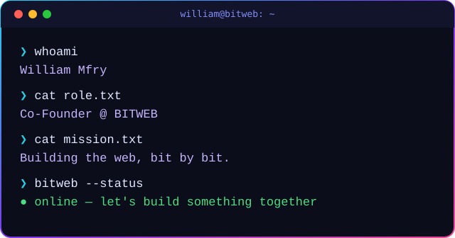

  

  

  
  
  
  

## 👋 Hey, I'm William

<table>
<tr>
<td width="55%" valign="top">

I'm **William Mfry**, **co-founder of BITWEB**.

- 🚀 Building **BITWEB** — the web, bit by bit
- 🌐 Passionate about the web and digital products
- 🤝 Open to collaborations and new projects
- ⚡ Always shipping, always learning
- 💳 My business card: **[bitweb-carte.vercel.app](https://bitweb-carte.vercel.app)**

</td>
<td width="45%" valign="middle" align="center">

</td>
</tr>
</table>

## 💳 My BITWEB Business Card

<table>
<tr>
<td width="62%" valign="middle">

Call me, message me on WhatsApp, save my contact or send me your project in one tap.

On your phone? Scan the QR code to open it instantly.

</td>
<td width="38%" valign="middle" align="center">

</td>
</tr>
</table>

## 📊 GitHub Stats

  
  

  

  

